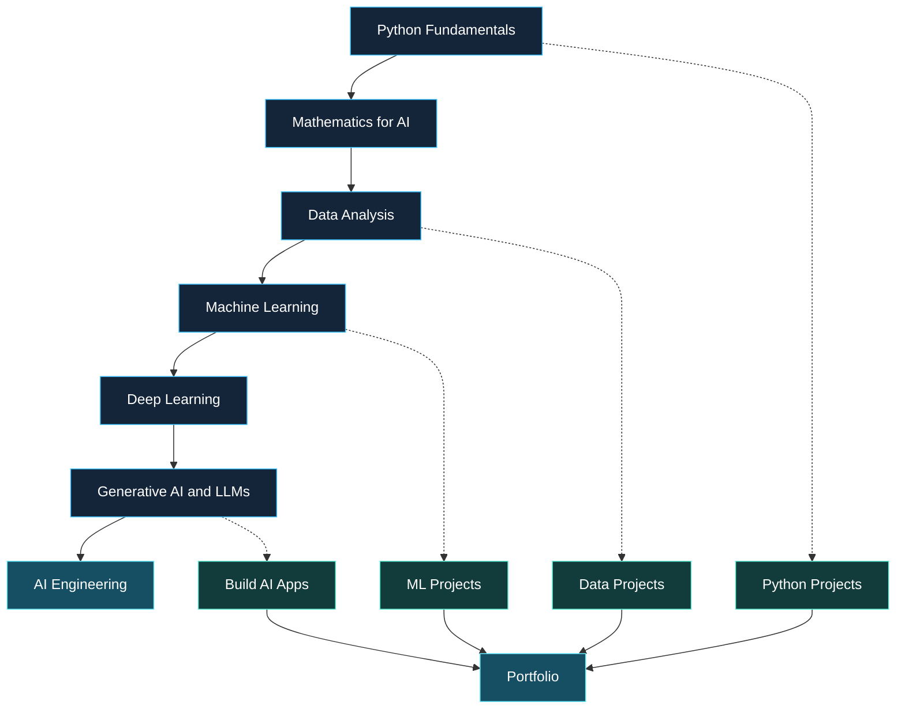

# Roshan Gaikwad

**Student · Aspiring AI Engineer**

I’m a student learning programming and exploring how AI can solve useful problems. I enjoy building small projects, improving my development skills, and turning ideas into working prototypes.

[Portfolio / Learning Project](https://interact18.netlify.app/) · [GitHub Profile](https://github.com/roshan1861gaikwad-code)

---

## About

- 🎓 Student focused on building strong foundations in computer science.
- 🐍 Learning Python and developing my problem-solving skills.
- 🤖 Interested in artificial intelligence, automation, and interactive learning tools.
- 🧪 Learning by building projects, testing ideas, and improving them step by step.

## Featured Project

### Interact — Interactive Learning Website

A learning project focused on Physics, Chemistry, and Mathematics, designed to make concepts easier to explore through an interactive website.

- **Live demo:** [interact18.netlify.app](https://interact18.netlify.app/)
- **Status:** Personal project; see the live site and repository for the current implementation.
- **Focus:** Educational content, navigation, and interactive learning experiences.

> The live demo link is included from my project information. I couldn't independently confirm its current availability during this README update.

## Skills & Tools

**Learning / using:** Python fundamentals, HTML, CSS, AI-assisted development tools.

**Currently exploring:** Data structures and algorithms, mathematics for AI, machine learning fundamentals, and better software-development practices.

*This list is intentionally conservative and should be updated as I gain practical experience.*

## Current Focus

1. Strengthen Python fundamentals and problem-solving.
2. Learn Git and GitHub workflows.
3. Build and document useful projects.
4. Progress toward mathematics, data structures, and machine learning.

## How I Build

- Keep project goals and limitations clear.
- Prefer working features over impressive-sounding claims.
- Document setup instructions and known issues.
- Improve projects in small, testable steps.

## GitHub Activity

<!-- Optional: Add a contribution/statistics card after verifying that it renders correctly.
     Avoid treating third-party statistics as a measure of engineering skill. -->

[View my repositories](https://github.com/roshan1861gaikwad-code?tab=repositories) · [View my contributions](https://github.com/roshan1861gaikwad-code?tab=overview)

---

Learning in public, one project at a time.

## My AI Engineer Roadmap

